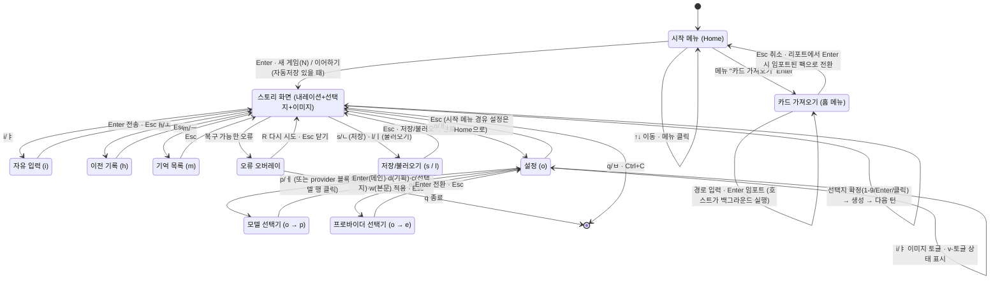

# StoryTUI 화면·탐색 그래프

코드에서 추출한 실제 전환 관계(`crates/story-tui` 기준, 2026-10-15).
키는 2벌식 한글 별칭과 함께 표기한다(예: `v/ㅓ`).

## 전체 그래프

## 화면별 사용 가능 동작

### 자유 입력 (i)

- `Enter` 전송 · `Esc` 취소
- 커서 이동 `←→` / `Home` / `End`, 백스페이스·Delete, 붙여넣기(브래킷 페이스트)

### 스토리 화면 (게임 중)

| 키 | 동작 |
|---|---|
| `1-9` / `Enter` / 선택지 클릭 | 선택 확정 → 턴 생성 |
| `↑↓` / `k/ㅏ` `j/ㅓ` | 선택 이동 |
| `R/ㄱ` | 선택지 다시 만들기 |
| `c/ㅊ` | 생성 취소 (로딩 중) |
| `i/ㅑ` | 자유 입력 모드 (선택지가 있고 로딩·오류가 없을 때만) |
| `h/ㅗ` · `m/ㅡ` | 이전 기록 · 기억 목록 |
| `s/ㄴ` · `l/ㅣ` | 저장 · 불러오기 |
| `v/ㅓ` | **TTS 낭독 켜기/끄기** (게임 중 즉시) |
| `o/ㅐ` | 설정 열기 |
| `Home` | 시작 메뉴 (상태 패널의 `[Home] 홈` 텍스트 클릭도 동일) |
| `n/ㅜ` | ⚠ 확인 없이 즉시 새 게임(현재 진행 리셋) — 의도치 않은 입력 주의 |
| `Alt+Home` | 내레이션 맨 위로 스크롤 |
| `PgUp/PgDn` · 휠 | 내레이션 스크롤 |
| `q/ㅂ` · `Ctrl+C` | 종료 |

### 설정 화면 (`o`) — 게임 중에도 전부 변경 가능

| 키 | 동작 | 유지 위치 |
|---|---|---|
| `p/ㅔ` | 모델 선택 (메인/기획/선택지/본문) | user-settings.toml |
| `e/ㄷ` | 프로바이더 전환 (재시작 불필요) | user-settings.toml |
| `i/ㅑ` | **장면 이미지 켜기/끄기** | user-settings.toml |
| 상태 블록 | TTS(v) 상태·백엔드·보이스, 이미지 프로토콜(kitty 등) 표시 | — |
| `Esc` | 닫기 · `q` 종료 | — |

### 카드 가져오기 (시작 메뉴)

- 시작 메뉴에서 `카드 가져오기` 선택 → 경로 입력 모달
- 대상: SillyTavern/RisuAI 캐릭터 카드 (PNG `chara`/`ccv3` 임베디드 또는 `.json`, V1/V2/V3)
- `Enter` 임포트 → 호스트가 백그라운드 실행 → 리포트 표시 (로어북 엔트리 수,
  매핑/근사/경고/무시 필드 요약)
- 리포트에서 `Enter` → 임포트된 팩(`stories/<slug>`)으로 즉시 전환(새 엔진),
  `Esc` → 닫기 (기존 팩 유지)
- World Info 병합·언어·플레이어 호칭 등 세부 옵션은 CLI 사용:
  `storytui import --help` (`--normalize` 정규화 패스 포함)
- 상세 정책: `crates/story-import` 모듈 문서와 임포트 리포트(`import-report.md`)

### 이미지 표시 규칙

- 경로: `pack/images/locations/<장소id>.png` → 없으면 `pack/images/characters/<캐릭터id>.png`
  (확장자 png→jpg→jpeg→webp 순, 손상 파일은 건너뜀)
- 프로토콜: 시작 시 터미널 질의 — kitty(Ghostty/kitty/WezTerm)·sixel·halfblocks 자동 감지,
  미지원이면 비활성. 설정 화면의 상태 블록에서 감지 결과를 확인할 수 있다.
- 끄는 방법: 설정에서 `i` — 이미지 파일을 지울 필요 없다.

## 게임 중 변경 가능 항목 요약

| 항목 | 위치 | 즉시 적용 |
|---|---|---|
| 모델 (메인/기획/선택지/본문) | 설정 `p` | ✓ |
| 프로바이더 (엔드포인트+키) | 설정 `e` | ✓ |
| TTS 낭독 | `v` | ✓ |
| 장면 이미지 | 설정 `i` | ✓ |
| 저장/불러오기 | `s` / `l` | ✓ |
| 스토리 팩 자체 | 불가 (재시작 필요) | — |
| 엔드포인트 자유 입력 | 불가 (TOML 프로필 정의 → TUI는 전환) | — |
