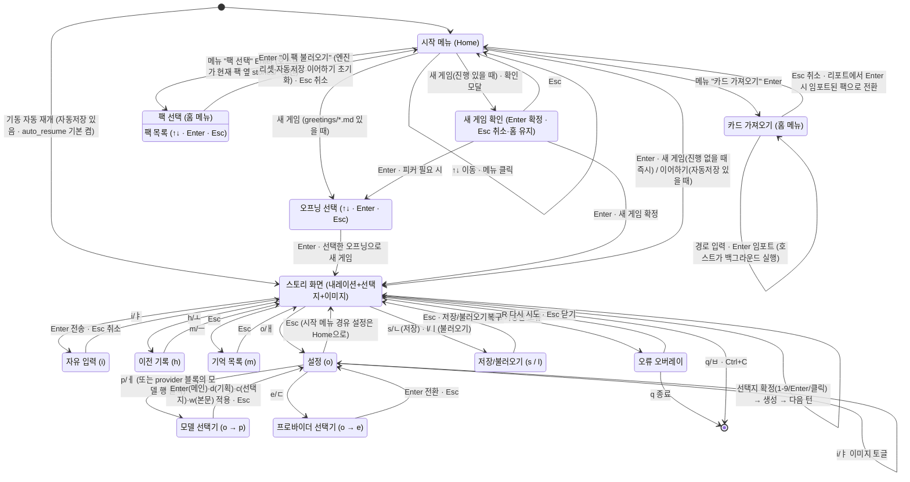

# StoryTUI 화면·탐색 그래프

코드에서 추출한 실제 전환 관계(`crates/story-tui` 기준, 2026-10-23).
키는 2벌식 한글 별칭과 함께 표기한다(예: `v/ㅓ`).

## 전체 그래프

## 화면별 사용 가능 동작

### 자유 입력 (i)

- `Enter` 전송 · `Esc` 취소
- `@캐릭터이름 내용` — 캐스트 중 가장 긴 이름을 대상으로 지정(target)해 말을 검.
  이름 뒤 내용만 `content`가 되고 입력 전문은 그대로 보존. `@` 일치가 없으면 일반
  자유 입력과 동일
- 커서 이동 `←→` / `Home` / `End`, 백스페이스·Delete, 붙여넣기(브래킷 페이스트)

### 스토리 화면 (게임 중)

| 키 | 동작 |
|---|---|
| `1-9` / `Enter` / 선택지 클릭 | 선택 확정 → 턴 생성 |
| `↑↓` / `k/ㅏ` `j/ㅓ` | 선택 이동 |
| `R/ㄱ` | 선택지 다시 만들기 · **생성 중에는 같은 턴 다시 만들기**(같은 체크포인트에서 새로 생성) |
| `u/ㅕ` | **직전 턴 되돌리기** — 확정한 턴을 취소하고 직전 선택지로 복귀 (되돌릴 턴이 없거나 로딩·오류 중에는 무시). 되돌린 상태가 즉시 자동 저장됨 |
| `[ / ]` | **변형 순환** — 되돌렸다가 다시 확정한 턴의 내레이션을 보관된 대안 사이에서 순환 (배지 "변형 n/m", 자동 저장도 함께 갱신. 보관은 세션 메모리 — 재시작하면 사라짐) |
| `c/ㅊ` | 생성 취소 (로딩 중) |
| `i/ㅑ` | 자유 입력 모드 (선택지가 있고 로딩·오류가 없을 때만) |
| `h/ㅗ` · `m/ㅡ` | 이전 기록 · 기억 목록 |
| `s/ㄴ` · `l/ㅣ` | 저장 · 불러오기 |
| `v/ㅓ` | **TTS 낭독 켜기/끄기** (게임 중 즉시) |
| `w/ㅈ` | **이어쓰기** — 마지막 내레이션을 새 턴 없이 연장 (선택지·상태 유지, 다음 자동 저장에 반영) |
| `z/ㅋ` | **대필** — AI가 제안하는 다음 행동 한 문장을 자유 입력에 채움 (전송은 Enter) |
| `g/ㅎ` | **인물 대화** — 캐스트 둘 이상이 `이름: "대사"` 형식으로 이어 대화하는 장면 비트 1회를 직전 내레이션에 부착 (턴·선택지·상태 유지, 다음 자동 저장에 반영) |
| `p/ㅔ` | **인물 목록** — 캐스트 로스터 열람 (이름 · 관계단계 · 감정 · 호감/신뢰/긴장) · `Esc` 닫기 |
| `Alt+1..9` | **퀵 입력** — user-settings `[quick_actions]`에 저장한 문구를 입력 버퍼에 채움 (설정 시에만) |
| `o/ㅐ` | 설정 열기 |
| `Home` | 시작 메뉴 (상태 패널의 `[Home] 홈` 텍스트 클릭도 동일) |
| `n/ㅜ` | 새 게임 **확인 모달**(턴 > 0일 때) — Enter 확정·Esc 취소. 턴 0(시작 전)은 즉시 시작 |
| `Alt+Home` | 시작 메뉴 (`Home`과 동일하게 동작 — 예전 "맨 위로 스크롤" 바인딩은 Home 진입에 가려진 상태, 후속 정리 대상) |
| `PgUp/PgDn` · 휠 | 내레이션 스크롤 |
| `q/ㅂ` · `Ctrl+C` | 종료 |

자동 보조(키 없음 — 안내는 상태줄·배지로만 표시): 생성 실패 시 오버레이 전에 1회 자동
재시도(1.5s 뒤, "자동 재시도…(1/1)" — 취소 제외, 2회째 실패는 수동 [R]). 서버가 꺼져
있으면 ~15s 간격 자동 재탐색으로 상태줄이 갱신된다. 산문이 토큰 한도로 잘리면
(finish_reason "length") 턴당 1회 자동 이어쓰기 + "✎ 이어씀" 배지(그 턴에 수리가 이미
돌았으면 "잘림 — w로 이어쓰기" 수동 안내만). 이어쓰기·인물 대화의 빈 결과는 1회 재시도
뒤 토스트로 안내한다.

### 설정 화면 (`o`) — 게임 중에도 전부 변경 가능

| 키 | 동작 | 유지 위치 |
|---|---|---|
| `p/ㅔ` | 모델 선택 (메인/기획/선택지/본문) — 역할별 선택은 현재 프로필에 귀속 | user-settings.toml |
| `e/ㄷ` | 프로바이더 전환 (재시작 불필요) — 전환 시 그 프로필의 역할 모델 배정도 함께 복원 | user-settings.toml |
| `i/ㅑ` | **장면 이미지 켜기/끄기** | user-settings.toml |
| `g/ㅎ` | **생성 방식 전환** — 단일 패스 ↔ 2단계(기획→본문 스트리밍). 다음 턴부터 적용 | user-settings.toml |
| `x/ㅌ` | **스타일 프리셋 순환** — 자동 → 창의적 → 균형 → 정밀. temperature/top_p/top_k를 한 번에, 다음 턴부터 적용. "자동"은 프로필 고유 튜닝 따름 | user-settings.toml |
| `a/ㅁ` | **페르소나 편집** — 이름·페르소나 모달 (Tab 이동 · Enter 적용 · Esc 취소). 다음 턴 프롬프트부터 반영. 빈 값 = 그 항목 끔 | user-settings.toml |
| `t/ㅅ` | **작가 노트** — 매 턴 프롬프트에 그대로 들어가는 조향 지시 (Enter 적용 · Esc 취소). 빈 값 = 끔 | user-settings.toml |
| `w/ㅈ` | **로어북** — 엔트리 열람 · `Space` 활성 토글 · `Enter` 내용 편집 · `k` 키 편집. 다음 턴부터 반영. 팩에 lorebook.toml이 있으면 저장, 없으면 세션 전용 | lorebook.toml (있을 때) |
| `r/ㄱ` | **프롬프트 미리보기** — 마지막으로 전송된 system·user 프롬프트 열람 (스크롤 · Esc 닫기). 세션 메모리만 | — |
| 상태 블록 | TTS(v) 상태·백엔드·보이스, 이미지 프로토콜(kitty 등), 생성 방식, 페르소나 표시 | — |
| `Esc` | 닫기 · `q` 종료 | — |

### 오프닝 선택 (greetings)

- 임포트된 팩에 `greetings/N.md`가 있으면 새 게임 시 오프닝 선택 모달이 먼저 뜬다
  (0번은 항상 팩 기본 오프닝 = first_mes)
- `↑↓`/`k·j` 이동, `Enter` 확정, `Esc` 취소(시작하지 않음)
- 선택한 인사는 그 세션의 `opening.md`로 사용되며 팩 파일은 변경되지 않는다

### 카드 가져오기 (시작 메뉴)

- 시작 메뉴에서 `카드 가져오기` 선택 → 경로 입력 모달
- 대상: SillyTavern/RisuAI 캐릭터 카드 (PNG `chara`/`ccv3` 임베디드 또는 `.json`, V1/V2/V3)
- `Enter` 임포트 → 호스트가 백그라운드 실행 → 리포트 표시 (로어북 엔트리 수,
  매핑/근사/경고/무시 필드 요약)
- 리포트에서 `Enter` → 임포트된 팩(`stories/<slug>`)으로 즉시 전환(새 엔진),
  `Esc` → 닫기 (기존 팩 유지)
- World Info 병합·언어·플레이어 호칭 등 세부 옵션은 CLI 사용:
  `storytui import --help` (`--normalize` 정규화 패스 포함)
- 상세 정책: `crates/story-import` 모듈 문서와 임포트 리포트(`import-report.md`)

### 팩 선택 (시작 메뉴)

- 시작 메뉴 마지막 행 `팩 선택` → 호스트가 현재 팩의 형제 디렉터리에서
  `story.toml`을 가진 팩을 스캔해 모달로 나열한다 (`제목 · 언어` 라벨, 현재 팩은
  " (현재)" 표시)
- 깨진 manifest를 가진 디렉터는 경고 로그 후 건너뛴다 — 하나의 불량 팩이 메뉴를
  막지 않는다
- `Enter` → 기존 임포트 전환 경로 재사용: PackLoader 검증 → 엔진 리셋 → 자동저장
  이어하기 초기화 → 새 팩의 인사말 재스캔. 로드 실패 시 오류 오버레이로 격리되고
  기존 팩이 유지된다
- `Esc` → 취소 (팩 변경 없음)

### 이미지 표시 규칙

- 경로: `pack/images/locations/<장소id>.png` → 없으면 `pack/images/characters/<캐릭터id>.png`
  (확장자 png→jpg→jpeg→webp 순, 손상 파일은 건너뜀)
- 표정 스프라이트: `pack/images/expressions/<캐릭터id>/<감정>.png`
  (`neutral`·`happy`·`sad`·`angry`·`anxious`·`surprised`·`affectionate`·`cold`·
  `embarrassed`·`guilty`) → 없으면 캐릭터 초상으로 폴백. 감정은 각 턴 내레이션을
  키워드 분류한 결과 — **모델 추가 호출 없이** 결정되며, 감정이 바뀐 턴 앞에만
  인라인 삽입된다 (같은 그림 연속·초상 중복은 생략).
- 프로토콜: 시작 시 터미널 질의 — kitty(Ghostty/kitty/WezTerm)·sixel·iterm2·halfblocks
  자동 감지, 미지원이면 비활성. 설정 화면 상태 블록의 image 행에서 감지 결과와
  자동/수동 여부를 확인할 수 있다.
- 렌더 방식 수동 선택: 설정에서 `b` — 자동 → kitty → sixel → iterm2 → halfblocks →
  자동 순환. 선택은 `user-settings.toml`에 저장되고 전환 즉시 표시 중 이미지가 새
  방식으로 재인코딩된다. 터미널 감지가 실패한 세션에서는 halfblocks 강제만 가능하고,
  자동(기본)은 항상 감지 결과를 따른다.
- 끄는 방법: 장면 이미지는 설정에서 `i`, 표정 스프라이트는 `f` — 이미지 파일을 지울 필요 없다.

## 게임 중 변경 가능 항목 요약

| 항목 | 위치 | 즉시 적용 |
|---|---|---|
| 모델 (메인/기획/선택지/본문) | 설정 `p` | ✓ |
| 프로바이더 (엔드포인트+키) | 설정 `e` | ✓ |
| 스타일 프리셋 (샘플링 자동 튜닝) | 설정 `x` | ✓ (다음 턴부터) |
| 페르소나 (이름·성정) | 설정 `a` | ✓ (다음 턴 프롬프트부터) |
| 작가 노트 (조향 지시) | 설정 `t` | ✓ (다음 턴 프롬프트부터) |
| 로어북 편집 (키·내용·활성·상수·확률) | 설정 `w` — `Space` 활성 · `Enter` 내용 · `k` 키(`\,`=쉼표) · `c` 상수 · `p` 확률 | ✓ (다음 턴부터 · lorebook.toml 있으면 영속) |
| 프롬프트 미리보기 | 설정 `r` | — (열람 전용) |
| 이어쓰기 | `w` | ✓ (직전 내레이션 연장) |
| 대필 제안 | `z` | ✓ (입력 버퍼 채움) |
| 인물 대화 | `g` | ✓ (직전 내레이션 부착 · 상태 불변) |
| 인물 목록 | `p` | — (열람 전용) |
| 퀵 입력 문구 | `Alt+1..9` (TOML 구성) | ✓ (입력 버퍼 채움) |
| 표시 규칙 (regex 치환) | user-settings `[[display_rules]]` (TOML 전용) | ✓ (새 표시 텍스트부터) |
| 세이브 내보내기 | CLI `storytui export <슬롯> [--format txt\|jsonl]` | — (파일 산출) |
| TTS 낭독 | `v` | ✓ |
| 장면 이미지 | 설정 `i` | ✓ |
| 이미지 렌더 방식 (자동/수동) | 설정 `b` | ✓ |
| 표정 스프라이트 | 설정 `f` | ✓ |
| 생성 방식 (단일 패스 ↔ 2단계 스트리밍) | 설정 `g` | ✓ (다음 턴부터) |
| 직전 턴 되돌리기 | `u` | ✓ (자동 저장도 함께 갱신) |
| 저장/불러오기 | `s` / `l` | ✓ |
| 스토리 팩 전환 | 시작 메뉴 "팩 선택" | ✓ (엔진 리셋) |
| 새 게임 확인 모달 | 홈 "새 게임"·게임 중 `n` (진행 있을 때) | ✓ (Enter 확정·Esc 취소) |
| 기동 자동 재개 | user-settings `auto_resume` (기본 켬) | ✓ (기동 시 · 자동저장 있을 때) |
| 생성 실패 자동 재시도 / 서버 자동 재탐색 | 자동 (키 없음 · 오버레이 [R] 유지) | ✓ |
| 잘림 자동 이어쓰기 | 자동 (턴당 1회 · 수리 선사용 턴은 수동 `w` 안내) | ✓ |
| 엔드포인트 자유 입력 | 불가 (TOML 프로필 정의 → TUI는 전환) | — |
